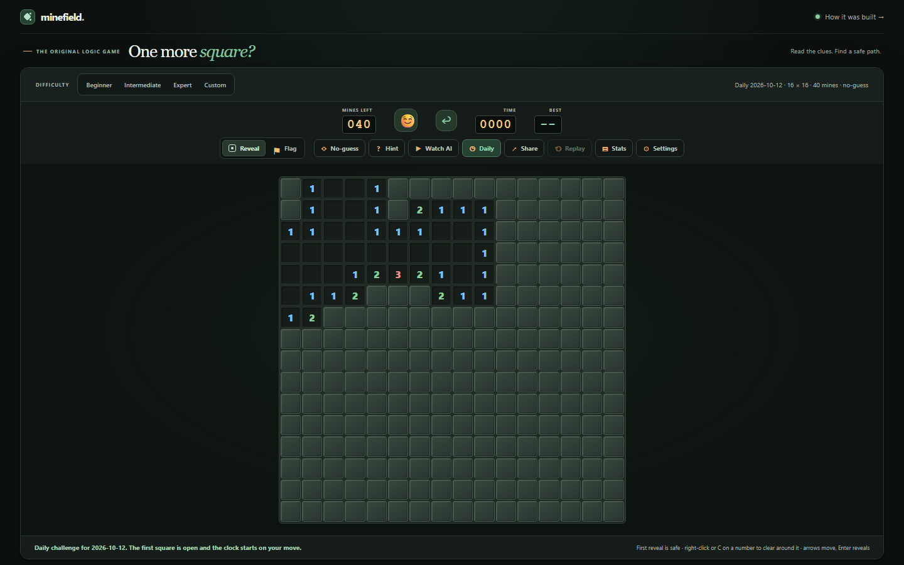

# Minefield

> A classic Minesweeper game, built through agentic coding.

**[Play Minefield](https://huu-dat-nguyen.github.io/agentic-minesweeper/)** · **[Source on GitHub](https://github.com/Huu-Dat-Nguyen/agentic-minesweeper)** · **[Developer profile](https://github.com/Huu-Dat-Nguyen)**

Minefield is both a playable web game and a record of prompt-driven development. Human prompts set the direction; AI coding agents implement and test each iteration, from core game rules to responsive design and public release.

## Visual evolution

<p align="center">
  
  
</p>
<p align="center">
  <sub>Early playable build</sub>&nbsp;&nbsp;&nbsp;&nbsp;&nbsp;&nbsp;&nbsp;&nbsp;&nbsp;&nbsp;<sub>Current game with the daily challenge</sub>
</p>

The full story, prompt by prompt, is on the in-game **[How it was built](https://huu-dat-nguyen.github.io/agentic-minesweeper/build.html)** page.

## Prompt-to-product log

| Prompt focus | Result |
|---|---|
| Build a playable Minesweeper game | Added three difficulties, safe first reveal, clues, flags, timer, win/loss states, and a tested game engine. |
| Improve desktop play and number chording | Expanded the desktop board layout and added right-click clearing when adjacent flags match a clue. |
| Fill the screen, distinguish blank cells, and use a dark theme | Created the responsive dark interface with clearly raised covered tiles and recessed revealed tiles. |
| Prepare a public GitHub project | Published the source and enabled GitHub Pages for the live game. |
| Rewrite the README around agentic coding | Recast the project as a prompt-to-product record with a concise prompt/result log and evolution screenshots. |
| Execute the full improvement plan | Added custom boards (up to 24 × 40), undo, keyboard chording (C), best times per difficulty, a clamped mine counter, a four-digit timer, and a 16-test suite; pushed to the public repository. |
| Suggest ten expansions and build them one by one | Added a logic solver powering no-guess boards, hints, and an AI player that explains its moves; a daily challenge and shareable board links; game replay; stats with 3BV/s; offline play; accessibility settings; and a "How it was built" page. Fixed four bugs found along the way. 30 tests. |
| Add a database login to track players | Optional accounts on Supabase with private, insert-only game records protected by row-level security, a public leaderboard, and replayable game history; stats derived from saved games with the same rules as offline play. Checked live with a real account. Custom boards no longer keep a best time. |
| Rewrite the code under my coding rules and compare | Split the 1,102-line page script into 17 small modules with each piece of logic in one place; a move now repaints 2 squares instead of 480 (7.7 → 1.3 ms on Expert); 96 tests; every old board link and every screen unchanged; app code 14% larger. See [the comparison](report/rewrite-comparison.md). |

The images compare an early playable build with the current release. Historical full-size backups stay local; the README uses a cropped copy of the early screenshot.

## Game features

- Beginner (9 × 9), Intermediate (16 × 16), Expert (16 × 30), and Custom boards (up to 24 × 40).
- Safe first reveal, automatic empty-area reveal, flags, timer, mine counter, restart, and win/loss feedback.
- Right-click to flag a covered square or clear neighbors of a revealed number when adjacent flags match; press C on a revealed number to do the same from the keyboard.
- Undo any move; best times are remembered per difficulty in the browser.
- **No-guess mode**: boards that can always be solved by logic, checked by a built-in solver.
- **Hint**: highlights a square the numbers prove safe (or a mine) and explains why.
- **Watch AI**: the solver plays the board step by step and explains each move.
- **Daily challenge**: the same no-guess board for everyone each day, with a spoiler-free result to share.
- **Share**: a link that opens the exact same board for someone else.
- **Replay**: step through a finished game move by move, with mines shown faintly.
- **Stats**: games played, win rate, streaks, best and average times, and best 3BV/s per mode. Games with hints, the AI, or an undo after a loss don't count.
- **Settings**: colorblind-safe numbers, high contrast, sound effects, and reduced motion.
- **Accounts** (optional): sign in to save games, stats and best times to your account; signed out, everything stays in the browser.
- **Leaderboard**: the fastest unassisted wins per difficulty and for today's daily board.
- **History**: your recent games, each replayable move by move.
- Custom boards count in stats but keep no best time.
- Works offline and can be installed as an app.
- Touch-friendly reveal/flag controls, keyboard navigation, and accessible announcements.
- Responsive dark layout; large boards scroll within the game area.
- No framework, dependencies, or build step; accounts use a Supabase database through plain `fetch` (`supabase/schema.sql`).

## Play and test locally

Serve the folder locally (browsers block the game's JavaScript modules when `index.html` is opened straight from disk):

```powershell
py -m http.server 8000
```

Then visit <http://localhost:8000>.

Choose **Reveal** or **Flag**, then select a square. On desktop, right-click to flag or chord a revealed number, or press **C** on a revealed number to clear its neighbors. With the board focused, use the arrow keys to move, Enter or Space to activate a square, and C to chord. **Undo** (↩) takes back the last move; best times persist per difficulty. The tools row holds No-guess, Hint, Watch AI, Daily, Share, Replay, Stats, and Settings.

Run the tests with Node.js 18 or later; no packages are needed:

```powershell
node --test
```

The game rules live in `core/` (pure modules, no page code), the page pieces in `ui/`, saved data in `data/`, and `app.mjs` wires them together.

## Deployment

The public site is served by GitHub Pages from the `main` branch root. New pushes to `main` deploy automatically.
