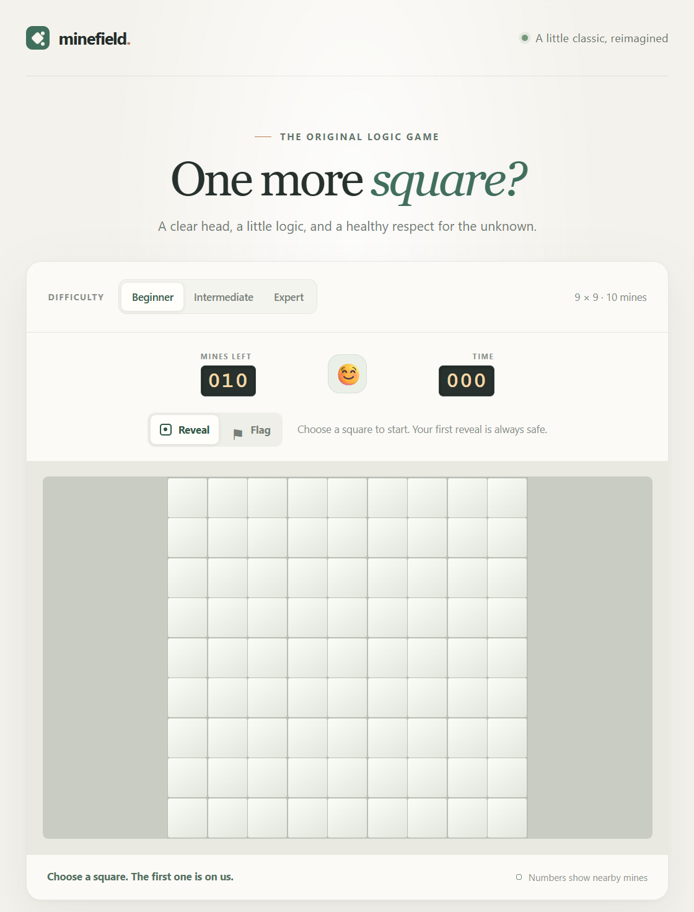
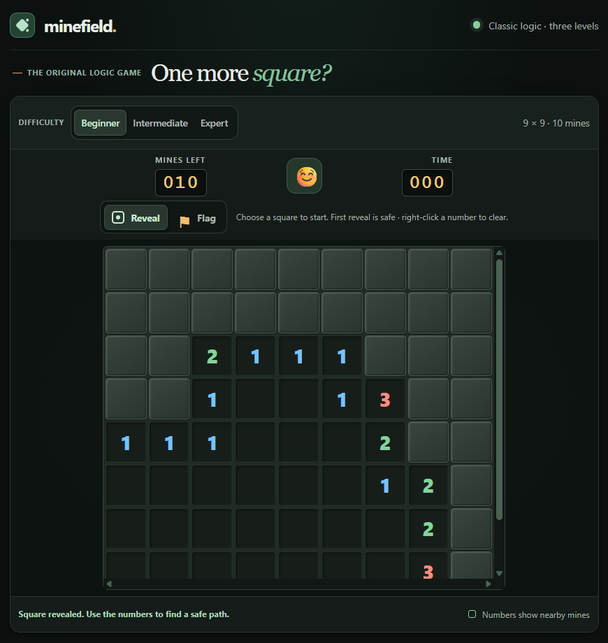

# Minefield

> A classic Minesweeper game, built through agentic coding.

**[Play Minefield](https://huu-dat-nguyen.github.io/agentic-minesweeper/)** · **[Source on GitHub](https://github.com/Huu-Dat-Nguyen/agentic-minesweeper)** · **[Developer profile](https://github.com/Huu-Dat-Nguyen)**

Minefield is both a playable web game and a record of prompt-driven development. Human prompts set the direction; AI coding agents implement and test each iteration, from core game rules to responsive design and public release.

## Visual evolution

<p align="center">
  
  
</p>
<p align="center">
  <sub>Early playable build</sub>&nbsp;&nbsp;&nbsp;&nbsp;&nbsp;&nbsp;&nbsp;&nbsp;&nbsp;&nbsp;<sub>Current dark-theme game</sub>
</p>

## Prompt-to-product log

| Prompt focus | Result |
|---|---|
| Build a playable Minesweeper game | Added three difficulties, safe first reveal, clues, flags, timer, win/loss states, and a tested game engine. |
| Improve desktop play and number chording | Expanded the desktop board layout and added right-click clearing when adjacent flags match a clue. |
| Fill the screen, distinguish blank cells, and use a dark theme | Created the responsive dark interface with clearly raised covered tiles and recessed revealed tiles. |
| Prepare a public GitHub project | Published the source and enabled GitHub Pages for the live game. |

The images compare an early playable build with the current release. Historical full-size backups stay local; the README uses a cropped copy of the early screenshot.

## Game features

- Beginner (9 × 9), Intermediate (16 × 16), and Expert (16 × 30).
- Safe first reveal, automatic empty-area reveal, flags, timer, mine counter, restart, and win/loss feedback.
- Right-click to flag a covered square or clear neighbors of a revealed number when adjacent flags match.
- Touch-friendly reveal/flag controls, keyboard navigation, and accessible announcements.
- Responsive dark layout; large boards scroll within the game area.
- No framework, dependencies, backend, or build step.

## Play and test locally

Open `index.html` in a modern browser, or run:

```powershell
py -m http.server 8000
```

Then visit <http://localhost:8000>.

Choose **Reveal** or **Flag**, then select a square. On desktop, right-click to flag or chord a revealed number. With the board focused, use the arrow keys to move and Enter or Space to activate a square.

Run the tests with Node.js 18 or later; no packages are needed:

```powershell
node --test
node --check .\app.mjs
node --check .\game-engine.mjs
```

## Deployment

The public site is served by GitHub Pages from the `main` branch root. New pushes to `main` deploy automatically.
